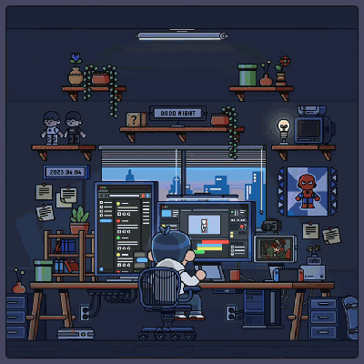

<h1 align="center">Teekay Vuyisile Manale</h1>

  Junior full-stack developer from South Africa. I enjoy building complete products,
  from the database to the interface, and shipping them live.

  
  
  

  
   
  Art: <a href="https://za.pinterest.com/pin/861946816230197834/">Dev Dreams by Rakibur Rahman</a>

## Tech stack

**Frontend** 

**Backend and data** 

**DevOps and cloud** 

Also: Socket.IO, WebRTC, LLM integration (Groq, Gemini), pytest, Vitest, Render.
